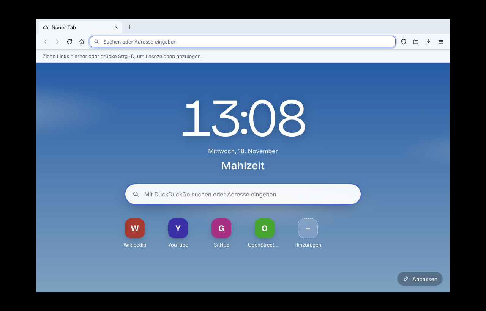
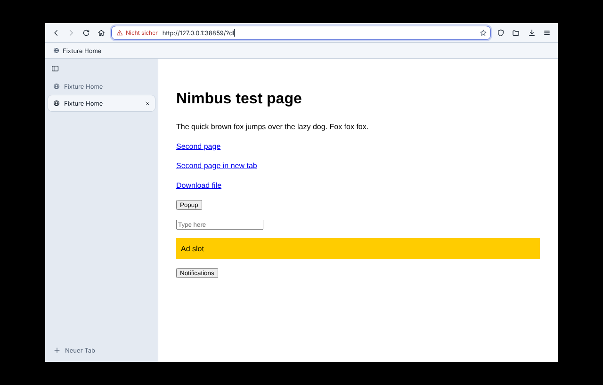
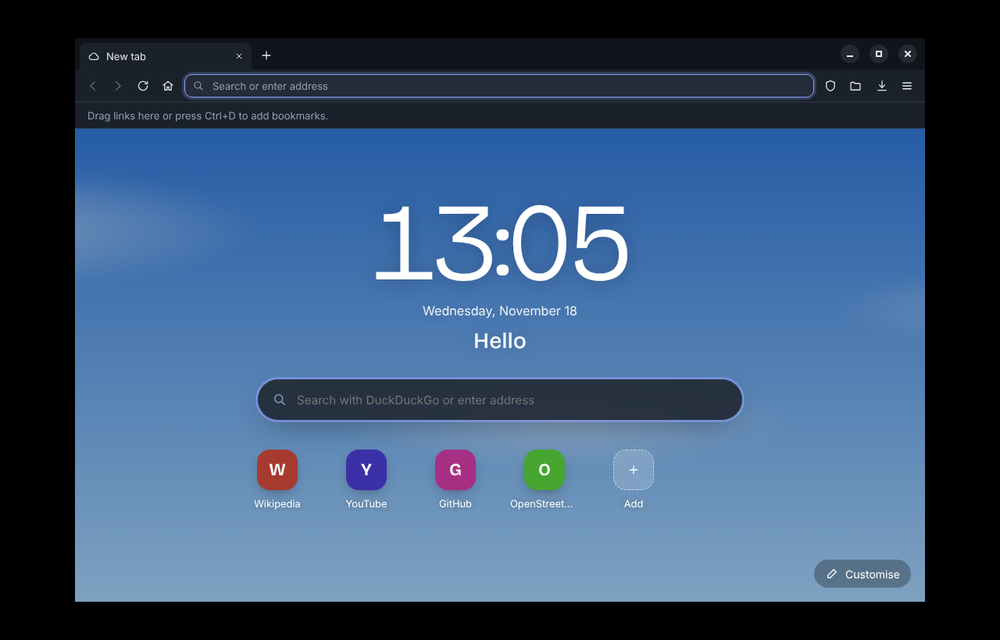
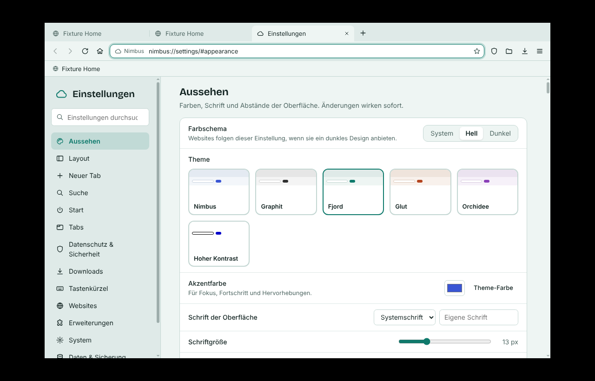

# Nimbus

**Ein schneller, einfacher und bis ins Detail anpassbarer Webbrowser für Windows und Linux.**

Nimbus basiert auf Chromium (über Electron) und zeigt Websites deshalb genauso an wie Chrome oder Edge. Darüber liegt eine eigene, schlanke Oberfläche, die du komplett nach deinen Vorstellungen einrichten kannst: Farben, Schrift, Tab-Position, Knöpfe, Tastenkürzel, Startseite, Datenschutz und mehr.



| Seitliche Tabs | Dunkles Theme, integrierte Titelleiste | Einstellungen |
|---|---|---|
|  |  |  |

---

## Installation

Fertige Pakete entstehen automatisch über GitHub Actions (siehe [Builds](#builds-erstellen)). Bei einem Release (Tag `v*`) hängen sie unter **Releases** an.

| System | Paket | Hinweis |
|---|---|---|
| Windows 10/11 (x64, ARM64) | `Nimbus-…-win-x64-nsis.exe` | Installer, ohne Admin-Rechte; registriert Nimbus unter „Standard-Apps“ |
| Windows (x64) | `Nimbus-…-portable.exe` | Ohne Installation; Profil liegt im Ordner `NimbusProfile` daneben |
| Linux (x64, ARM64) | `Nimbus-….AppImage` | Läuft auf fast jeder Distribution: `chmod +x` und starten |
| Debian/Ubuntu/Mint | `.deb` | `sudo apt install ./Nimbus-….deb` |
| Fedora/openSUSE | `.rpm` | `sudo dnf install ./Nimbus-….rpm` |
| Linux allgemein | `.tar.gz` | Entpacken und `./nimbus` starten |

Unter Linux funktioniert Nimbus mit X11 und Wayland (automatische Erkennung).

## Funktionen

**Surfen**
- Tabs mit Drag & Drop, Anheften, Stummschalten, Duplizieren, Tab-Gruppen (Name + Farbe, einklappbar) und „In neues Fenster verschieben“ (auch per Herausziehen)
- **Geteilte Ansicht**: zwei Tabs nebeneinander, Trennlinie verschiebbar
- Tabs oben oder **seitlich** (links/rechts, ein- und ausklappbar), kompakter Einzeilen-Modus
- Adressleiste mit Vorschlägen aus Verlauf, Lesezeichen, offenen Tabs und Suchmaschine, Inline-Vervollständigung und Suchkürzeln (z. B. `w Wien` → Wikipedia)
- Lesezeichen und Lesezeichenleiste mit Ordnern, Verlauf, Downloads (Pausieren/Fortsetzen), Suche auf der Seite, Zoom pro Website
- Private Fenster mit getrennter Sitzung, die beim Schließen gelöscht wird
- Sitzungswiederherstellung nach Neustart; inaktive Tabs **schlafen automatisch** und sparen so Arbeitsspeicher
- Fokus-Modus (Oberfläche ausblenden), Vollbild, Bild-im-Bild, Seite als HTML/MHTML/PDF speichern, Übersetzen, Task-Manager

**Datenschutz & Sicherheit**
- Eingebauter **Werbe- und Trackerblocker** (EasyList/EasyPrivacy-basierte Listen, wöchentliche Aktualisierung, eigene Regeln, abschaltbar pro Website über das Schild-Symbol)
- Drittanbieter-Cookies blockiert, *Do Not Track* und *Global Privacy Control*
- Nur-HTTPS-Modus, sicheres DNS (DNS über HTTPS mit Anbieterwahl)
- Berechtigungsabfragen (Kamera, Mikrofon, Standort, Benachrichtigungen …) mit gespeicherten Entscheidungen, eigene Bildschirmfreigabe-Auswahl
- Daten löschen nach Zeitraum oder automatisch beim Beenden

**Kompatibilität**
- Aktuelles Chromium: Websites, Web-Apps, Videokonferenzen, DRM-freie Medien, PWAs, WebGL usw. funktionieren wie in Chrome
- Chrome-kompatibler User-Agent (Electron-Kennung entfernt), umschaltbar
- **Chrome-Erweiterungen**: direkt aus dem Chrome Web Store installieren, per ID, als `.crx`/`.zip` oder entpackt; Toolbar-Knöpfe und Popups der Erweiterungen werden angezeigt
- HTTP-Anmeldung (Basic Auth), Proxy-Anmeldung, Popups mit `window.opener` (OAuth-Logins), externe Protokolle (`mailto:` …) mit Rückfrage
- Lesezeichen-Import aus Chrome, Firefox, Edge und Safari (HTML) oder Chromes `Bookmarks`-Datei

## Alles anpassen

Alle Optionen findest du unter **Menü ☰ › Einstellungen** (`Strg+,`) — mit Suchfeld. Änderungen wirken sofort.

| Bereich | Was du einstellen kannst |
|---|---|
| Aussehen | Hell/Dunkel/System, 6 Themes (u. a. Hoher Kontrast), Akzentfarbe, einzelne Farben, Schriftart und -größe, Dichte, Eckenradius, Animationen, Dunkelmodus für alle Seiten, **eigenes CSS für die Oberfläche** |
| Layout | Tab-Position, kompakter Modus, Tab-Breite, Schließen-Knopf, wo neue Tabs erscheinen, **Knöpfe der Symbolleiste ein-/ausblenden und umsortieren**, Lesezeichenleiste, vereinfachte Adressen, integrierte oder System-Titelleiste |
| Neuer Tab | Hintergrund (Tageszeit-Himmel, Farbe, Verlauf, eigenes Bild, Abdunkeln), Uhr (12/24 h, Sekunden), Datum, Begrüßung mit Name, Suchfeld, Schnellwahl-Kacheln und Spalten, oder eine beliebige eigene Seite |
| Suche | Standard-Suchmaschine (DuckDuckGo voreingestellt), eigene Suchmaschinen mit Kürzeln, Vorschläge |
| Start & Tabs | Sitzung wiederherstellen / Startseite / bestimmte Seiten, Schlafmodus-Zeit, Mittelklick, Doppelklick, Mausrad-Tabwechsel |
| Datenschutz | siehe oben, plus Standard-Berechtigungen pro Typ und Verwaltung gespeicherter Website-Berechtigungen |
| Tastenkürzel | **jede Aktion frei belegbar**, mehrere Kürzel pro Aktion, Konflikterkennung |
| Websites | Standard-Zoom, Zoom pro Seite, **eigene CSS-Styles und JavaScript-Skripte pro Website** |
| Daten & Sicherung | Einstellungen, Themes und Lesezeichen als eine JSON-Datei exportieren/importieren – so überträgst du deine Einrichtung zwischen Windows und Linux |

Die Oberfläche ist auf Deutsch und Englisch verfügbar (Einstellungen › System › Sprache).

## Wichtige Tastenkürzel

| Aktion | Kürzel |
|---|---|
| Neuer Tab / Fenster / privates Fenster | `Strg+T` / `Strg+N` / `Strg+Umschalt+N` |
| Tab schließen / wiederherstellen | `Strg+W` / `Strg+Umschalt+T` |
| Nächster / vorheriger Tab, Tab 1–8, letzter Tab | `Strg+Tab` / `Strg+Umschalt+Tab`, `Strg+1…8`, `Strg+9` |
| Adressleiste | `Strg+L`, `Alt+D`, `F6` |
| Auf Seite suchen | `Strg+F`, weiter mit `F3` / `Enter` |
| Lesezeichen setzen / Leiste ein-aus | `Strg+D` / `Strg+Umschalt+B` |
| Verlauf / Downloads / Einstellungen | `Strg+H` / `Strg+J` / `Strg+,` |
| Geteilte Ansicht / Tabs oben-seitlich | `Strg+Umschalt+S` / `Strg+Umschalt+E` |
| Zoom | `Strg++`, `Strg+-`, `Strg+0` |
| Fokus-Modus / Vollbild | `Strg+Umschalt+F` / `F11` |
| Entwicklerwerkzeuge | `F12` |

Alle Kürzel lassen sich unter Einstellungen › Tastenkürzel ändern.

## Wo liegen meine Daten?

| System | Profilordner |
|---|---|
| Windows | `%APPDATA%\Nimbus` |
| Windows (portabel) | `NimbusProfile` neben der `.exe` |
| Linux | `~/.config/Nimbus` |

Darin liegen u. a. `settings.json`, `bookmarks.json`, `history.json` und `session.json` – lesbares JSON, das du sichern kannst. Mit der Umgebungsvariable `NIMBUS_PROFILE=/pfad` startest du Nimbus mit einem anderen Profil.

## Bekannte Grenzen

- Erweiterungen: Die meisten gängigen Erweiterungen funktionieren. Einige Chrome-APIs (z. B. `chrome.commands`, Teile von `chrome.tabs`) fehlen in Electron noch; in privaten Fenstern sind Erweiterungen aus.
- Netflix & Co.: DRM (Widevine) ist im Standard-Electron nicht enthalten. Solche Dienste funktionieren nur mit einem Widevine-fähigen Electron-Build.
- Berechtigungen im Zustand „Fragen“ melden Websites vorab `denied`, die eigentliche Abfrage erscheint aber, sobald die Seite die Berechtigung anfordert.

---

## Für Entwickler

Voraussetzung: Node.js 22.

```bash
npm install
```

```bash
npm start
```

| Befehl | Zweck |
|---|---|
| `npm start` | Nimbus aus dem Quellcode starten |
| `npm test` | Unit-Tests (URL-Erkennung, Kürzel, Themes inkl. WCAG-Kontrast, Lesezeichen-Import/-Export, Einstellungen, Verlauf, CRX) |
| `npm run test:e2e` | Startet die echte App und prüft 33 Abläufe (Tabs, Navigation, Popups, Kürzel, Suche, Lesezeichen, Downloads, Werbeblocker, Erweiterung, Berechtigungen, geteilte Ansicht, Gruppen, Schlafmodus, Themes, Einstellungen, Fehlerseite, privates Fenster, Sitzungswiederherstellung). Unter Linux ohne Bildschirm: `xvfb-run -a npm run test:e2e` |
| `npm run lint` | Syntaxprüfung aller Quelldateien |
| `npm run dist:linux` / `npm run dist:win` | Installer bauen (Ausgabe in `dist/`) |

### Builds erstellen

Der Workflow [`.github/workflows/build.yml`](.github/workflows/build.yml) testet jeden Push und Pull Request und baut danach die Pakete für Windows (auf `windows-latest`) und Linux (auf `ubuntu-latest`). Ein Tag wie `v1.0.0` veröffentlicht sie zusätzlich als GitHub-Release.

```bash
git tag v1.0.0
```

```bash
git push origin v1.0.0
```

Windows-Installer werden am zuverlässigsten auf Windows gebaut; unter Linux ist für `--win` zusätzlich Wine nötig.

### Aufbau

```
src/
  main/        Hauptprozess: Fenster, Tabs, Einstellungen, Netzwerk/Datenschutz, Erweiterungen, IPC
  preload/     Brücken: ui.js (Browser-Oberfläche), pages.js (nur für nimbus://-Seiten)
  ui/          Browser-Oberfläche (Tabs, Symbolleiste, Popover) – HTML/CSS/JS ohne Framework
  pages/       Interne Seiten nimbus://newtab, settings, history, bookmarks, downloads, error
  shared/      Gemeinsamer Code für alle Seiten: URL-Logik, Themes, Tastenkürzel
  locales/     Übersetzungen (de, en)
test/unit, test/e2e
build/         Windows-Installer-Erweiterung (Registrierung als Browser)
```

- Jedes Fenster ist ein `BaseWindow`. Die Oberfläche ist eine transparente `WebContentsView`, jeder Tab eine eigene `WebContentsView` (sandboxed, Kontext-isoliert). Für Menüs und Dialoge wird die Oberfläche kurz über die Seiten gelegt.
- Die Oberfläche meldet per IPC, wo der Seitenbereich liegt; dadurch ist das Layout (Tabs oben/seitlich, geteilte Ansicht) reines CSS und frei anpassbar.
- Webseiten erhalten keinerlei Zugriff auf Nimbus-Funktionen: Die API existiert nur auf `nimbus://`-Seiten und der Hauptprozess prüft jede Anfrage auf ihre Herkunft.
- Alle Optionen stehen mit Standardwerten in [`src/main/defaults.js`](src/main/defaults.js); neue Einstellungen dort ergänzen und in [`src/pages/settings.js`](src/pages/settings.js) eine Zeile hinzufügen.
- Neue Sprache: `src/locales/<code>.js` mit denselben Schlüsseln wie `de.js` anlegen und in `src/main/i18n.js` eintragen.

Verwendete Bibliotheken: [Electron](https://www.electronjs.org/), [@ghostery/adblocker](https://github.com/ghostery/adblocker), [electron-chrome-extensions und electron-chrome-web-store](https://github.com/samuelmaddock/electron-browser-shell), [tldts](https://github.com/remusao/tldts), [adm-zip](https://github.com/cthackers/adm-zip), Schrift [Bricolage Grotesque](https://github.com/ateliertriay/bricolage) (OFL).

## Lizenz

GNU General Public License v3.0 – siehe [LICENSE](LICENSE).
